# IncidentGraph AI

[](https://incident-graph-ai.vercel.app)
[](https://github.com/Atharvsrivastav/IncidentGraphAI/actions/workflows/ci.yml)
[](https://www.typescriptlang.org/)
[](https://nextjs.org/)
[](https://opentelemetry.io/)
[](https://grafana.com/)
[](https://neon.tech/)
[](https://vitest.dev/)
[](docs/ROOT_CAUSE_BENCHMARK.md)
[](docs/RECRUITER_DEMO.md)

> **Intelligent, explainable incident investigation and root-cause analysis for distributed microservice architectures using directed graphs, deterministic algorithms, OpenTelemetry, Grafana Cloud, and evidence-grounded AI synthesis.**
>
> 🌐 **Live Production Demo**: [https://incident-graph-ai.vercel.app](https://incident-graph-ai.vercel.app)  
> 🎬 **Recruiter Demo Video**: [`docs/recordings/incident_graph_ai_recruiter_demo.mp4`](docs/recordings/incident_graph_ai_recruiter_demo.mp4) *(Silent 1080p Screen Recording Walkthrough, 1m 35s)*  
> 🎙️ **Companion Voiceover Script**: [`docs/DEMO_VOICEOVER.md`](docs/DEMO_VOICEOVER.md) *(Timed narration script for live presentation)*  
> 📑 **Recruiter Click-by-Click Guide**: [`docs/RECRUITER_DEMO.md`](docs/RECRUITER_DEMO.md)  
> 🏛️ **Architecture Deep-Dive**: [`docs/ARCHITECTURE_OVERVIEW.md`](docs/ARCHITECTURE_OVERVIEW.md)  
> ⚡ **Quick Test**: Click `1-Click Guided Demo` on the live homepage to inject a multi-tier outage, trace cascading blast radius, and run an evidence-grounded AI investigation in 30 seconds. (Zero API key required).

> [!NOTE]
> **Production Telemetry & AI Configuration**: The public deployment at [incident-graph-ai.vercel.app](https://incident-graph-ai.vercel.app) reports `mode: SIMULATION` with Grafana Cloud connectivity probes verified (Prometheus and Tempo available). Because an external OpenAI key is intentionally not configured in the public environment, the AI Investigator operates in deterministic simulation replay mode, providing reproducible incident briefs with evidence-ID cross-checking and zero external cost.

---

## 📸 Recruiter-Ready 16:9 Screenshot Tour

All screenshots below are captured from the active running application at 1920x1080 resolution:

### 1. Operations Overview Dashboard
The central command center displaying fleet health status, active incidents, telemetry breach timelines, and MTTR performance metrics:
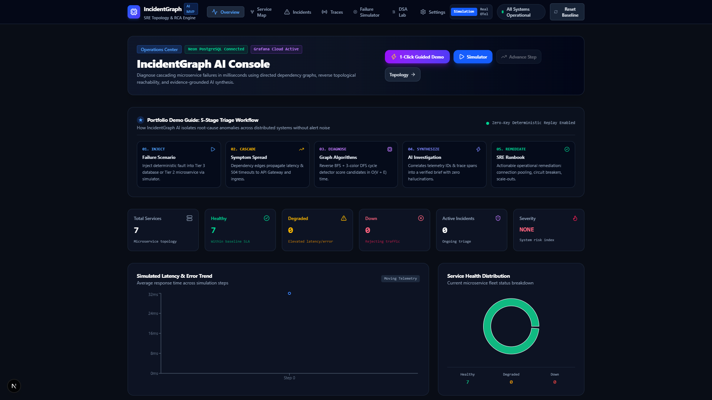

### 2. Interactive Service Dependency Graph
Dynamic topology map powered by React Flow (`@xyflow/react`). Directed dependency graph with color-coded health rings (Healthy, Degraded, Down), animated edge dependencies (`SYNC_HTTP`, `DATABASE_CONN`, `ASYNC_QUEUE`), cycle detection alerts, and real-time inspection drawers:
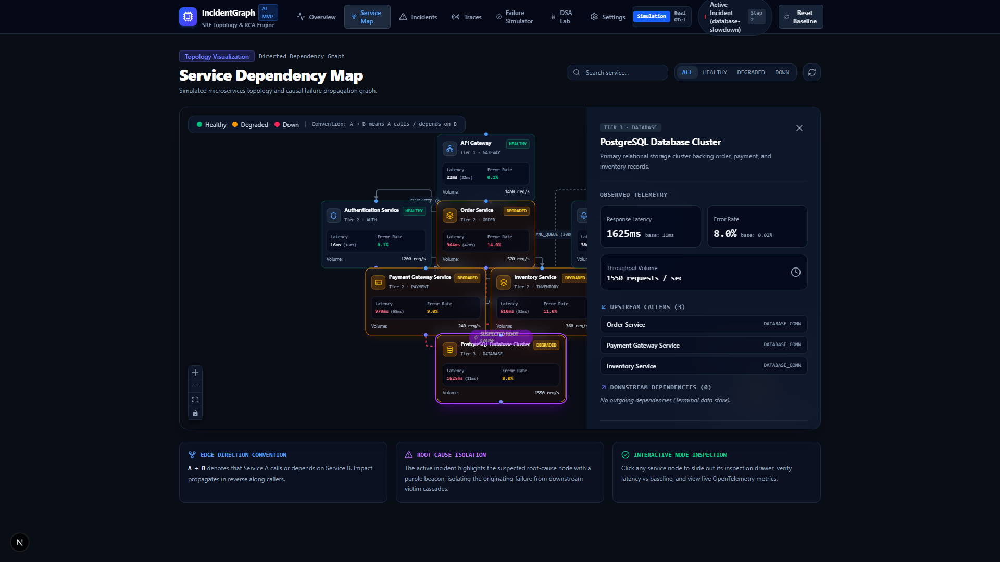

### 3. Deterministic Failure Simulator (Active Fault Injection)
Injects realistic failure scenarios (e.g., PostgreSQL connection pool exhaustion) and models multi-step cascading failure propagation along dependency edges:
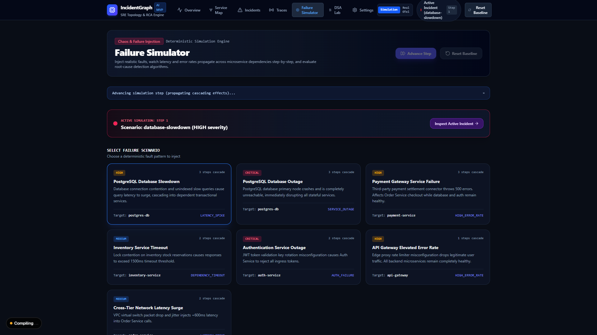

### 4. Incident Investigation & Root-Cause Ranking
Evidence-based candidate breakdown. Ranks originating services by combining graph blast-radius coverage, temporal onset, latency ratios, and error-rate deltas (e.g. `postgres-db` assigned a 94% deterministic ranking score):
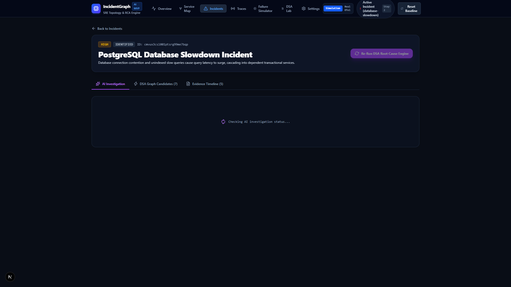

### 5. Evidence-Grounded AI Investigation & Replay
Deterministic AI investigation brief with verified impact, ranked hypotheses with supporting evidence IDs, read-only diagnostic checks, and safe remediation options:
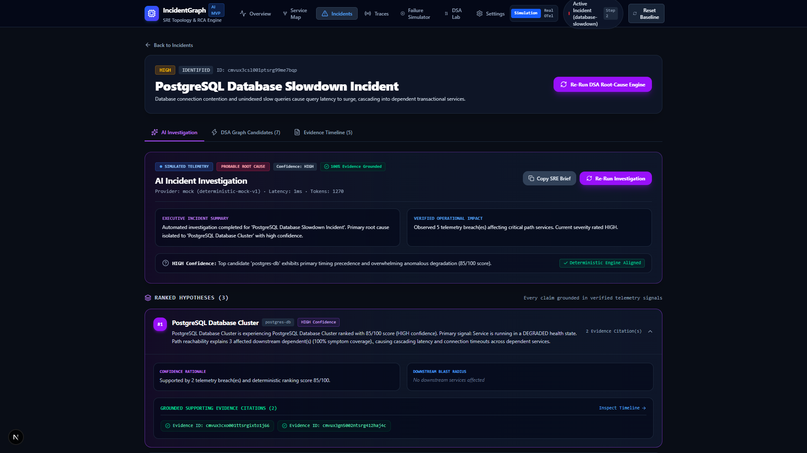

---

## 1. The Problem: Why Distributed Failure Triage Is Difficult

In modern microservice architectures, diagnosing outages is notoriously difficult due to **symptom cascading**:

1. **The Downstream Alert Storm**: When an underlying database suffers severe lock contention or disk saturation, it rarely fails in isolation. Every service depending on it begins exhausting its connection pool, accumulating request queues, and triggering HTTP 504 Gateway Timeouts at the ingress tier.
2. **Misleading Telemetry**: Ingress gateways exhibit the highest absolute volume of error logs and alert triggers, misleading on-call engineers into debugging the edge API rather than the root-cause database three hops deeper.
3. **Black-Box AI Unreliability**: Generative AI diagnostic wrappers often hallucinate connections, depend on unreliable internet connectivity, or leak proprietary operational traces to external model providers.
4. **Tooling Fragmentation**: Engineers must swivel between static architecture wikis, Prometheus dashboard spikes, and scattered distributed trace waterfalls to manually reconstruct the blast radius.

---

## 2. The Solution: IncidentGraph AI

**IncidentGraph AI** replaces guesswork with **deterministic graph algorithms**, **evidence-based heuristics**, and **grounded AI synthesis**. By modeling microservice topologies as a directed graph ($A \rightarrow B$ means service $A$ calls or depends on service $B$) and correlating live OpenTelemetry signals, it isolates the true originating failure in seconds.

### Key Highlights
- **100% Deterministic & Explainable**: Root causes are identified using proven graph traversal algorithms (Reverse BFS, 3-Color DFS) and a multi-factor ranking heuristic. No black-box hallucinations.
- **Evidence-Grounded AI Investigation**: Server-side LLM synthesis (`OpenAIProvider` or deterministic `MockAIProvider`) that correlates telemetry anomalies, trace spans, and graph reachability into an actionable SRE incident brief. Every claim is validated against genuine database evidence IDs, discarding hallucinated citations and enforcing calibrated uncertainty.
- **Zero Ground-Truth Leakage & Secret Redaction**: The analysis engine evaluates only observable runtime evidence without peeking at simulation ground truth. All credentials, tokens, and database passwords are automatically redacted before LLM transmission.
- **Dual Telemetry Modes with Truthful Provenance**: Operates offline via local SQLite and a deterministic chaos simulator, or connects to live production-grade **Grafana Cloud** (Prometheus Mimir + Tempo Traces) without requiring Docker or root privileges.
- **Interactive SRE Operations Console**: Visualizes service topologies, blast radius cascades, trace waterfalls, and algorithmic execution benchmarks in real time. Full incident triage with copyable Markdown incident briefs.

---

## 3. Product Tour & Screenshots

All screenshots below are captured from the active running application:

### Operations Overview Dashboard
The central command center displaying fleet health status, active incidents, telemetry breach timelines, and MTTR performance metrics:
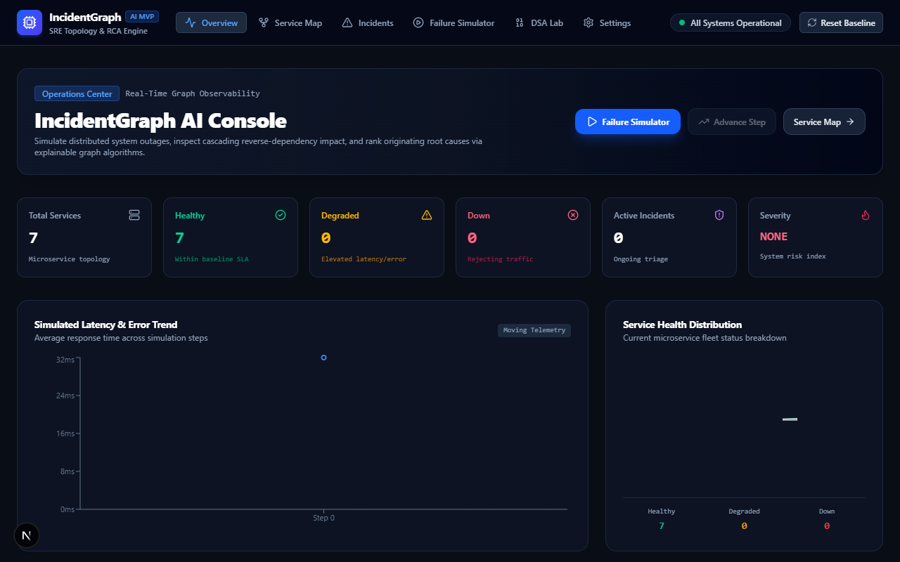

### Interactive Service Dependency Map
Dynamic topology map powered by React Flow (`@xyflow/react`). Color-coded health rings (Healthy, Degraded, Down), animated edge dependencies (`SYNC_HTTP`, `DATABASE_CONN`, `ASYNC_QUEUE`), and real-time inspection drawers:
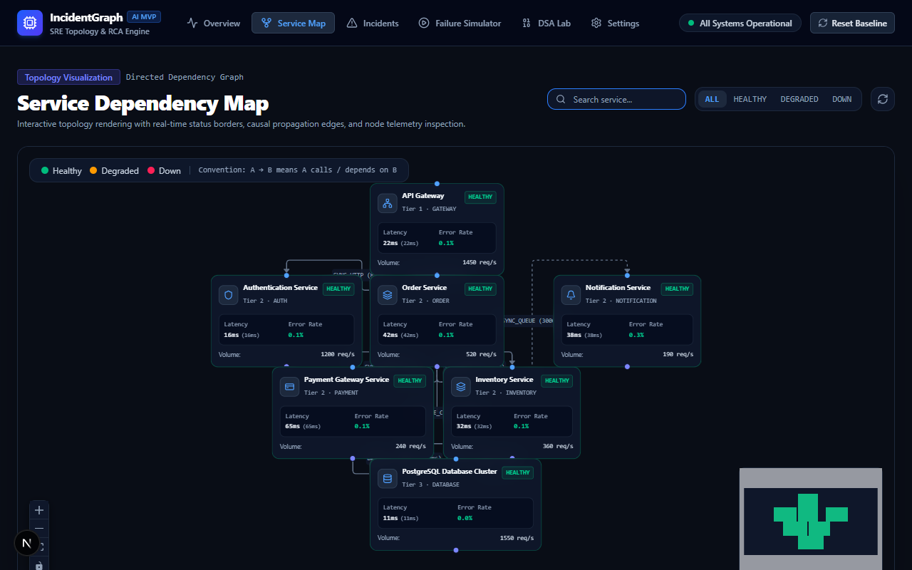

### 3. Deterministic Failure Simulator (Active Fault Injection)
Injects realistic failure scenarios (e.g., PostgreSQL disk latency, Auth key verification timeouts) and models multi-step cascading failure propagation along dependency edges using deterministic simulator-generated telemetry:
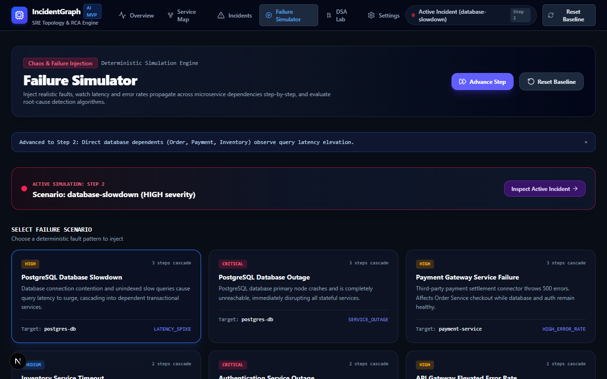

### 4. Incident Investigation & Root-Cause Ranking
Evidence-based candidate breakdown. Ranks originating services by combining graph blast-radius coverage, temporal onset, latency ratios, and error-rate deltas:
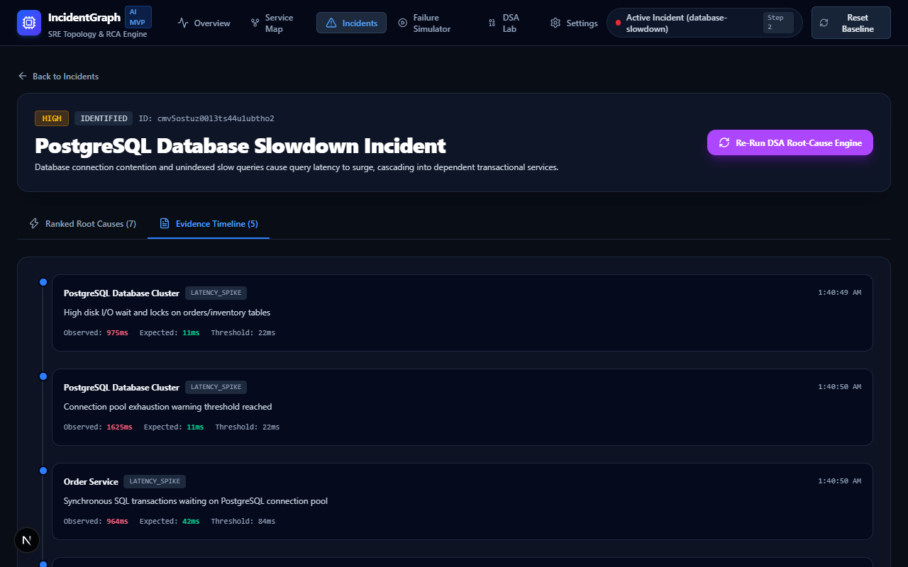

### 5. Trace Investigation Waterfall
Interactive distributed trace timeline inspecting multi-hop span latencies, W3C trace IDs, and database bottlenecks:
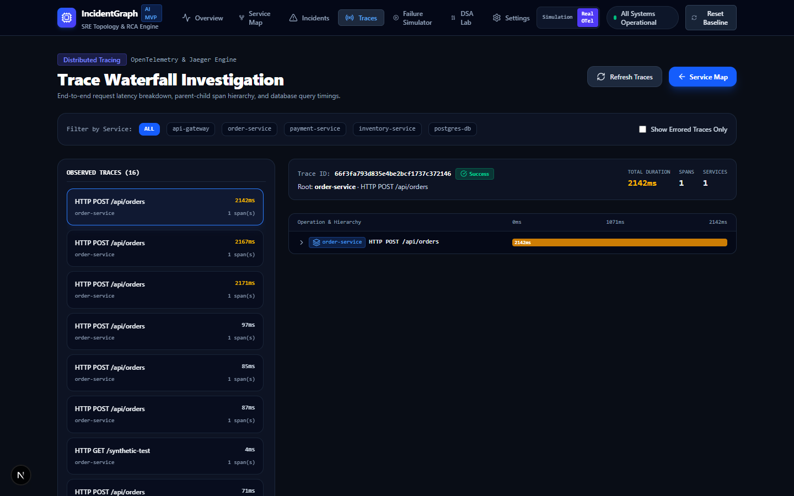

### 6. Real Cloud Telemetry Mode (Grafana Cloud Integration)
Supported real cloud mode: microservices mesh exporting directly to Grafana Cloud OTLP with verified Prometheus Mimir and Tempo probes (verified via `npm run test:cloud`; note that the public production web app reports `mode: SIMULATION` to avoid third-party cloud egress charges):
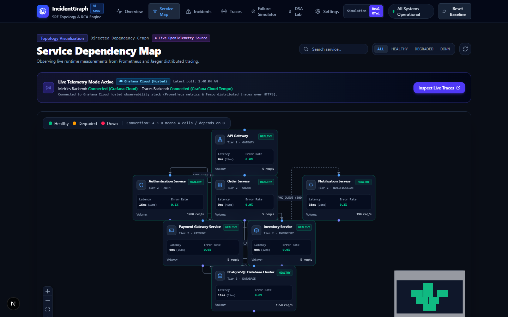

### 7. Interactive DSA Lab
Live visual laboratory demonstrating how the core computer science algorithms run under the hood with step-by-step execution metrics:
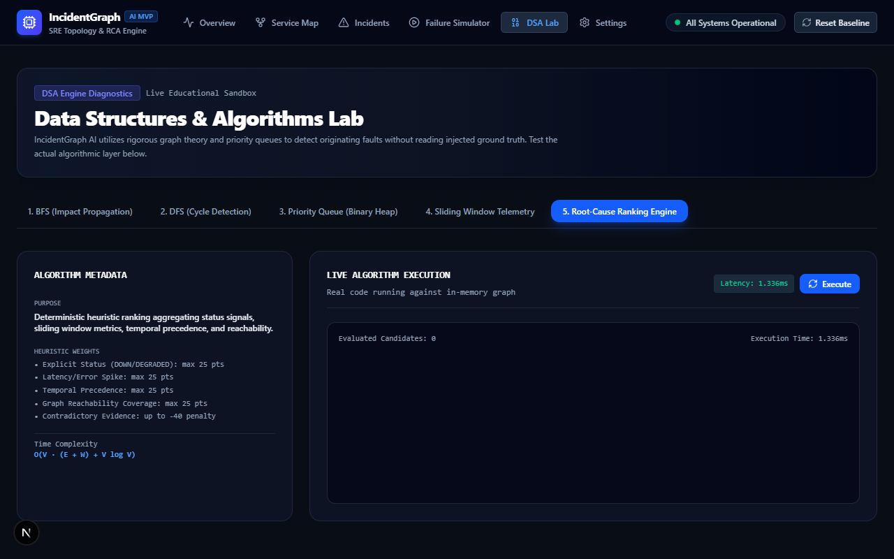

### 8. Fleet Recovery & Baseline Reset
Simulator restoration view showing automatic fleet health recovery, edge metric stabilization, and incident resolution:
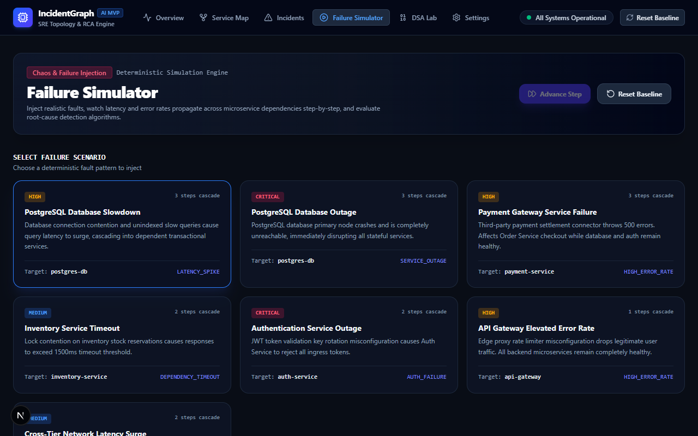

### Responsive Mobile Interface
Fully responsive SRE operations console optimized for mobile incident triage:
| Mobile Overview | Mobile Service Map | Mobile Incidents |
|:---:|:---:|:---:|
| 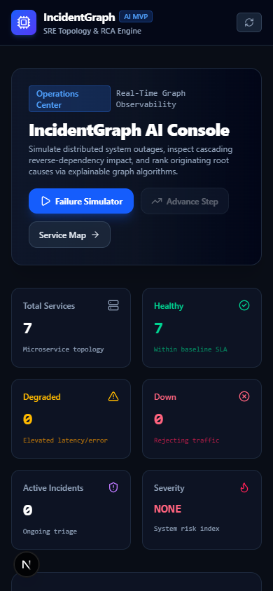 | 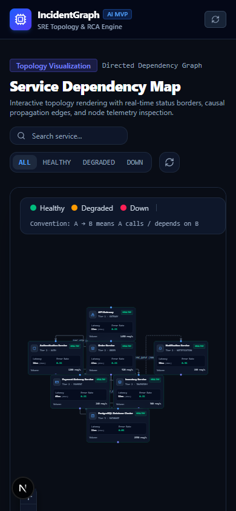 | 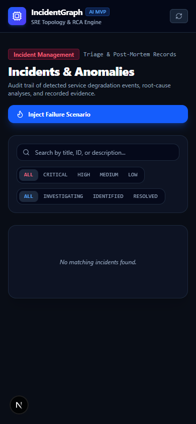 |

---

## 4. System Architecture

```mermaid
graph TD
    User([SRE Operator / Recruiter]) -->|HTTPS| NextApp[Next.js 16 Operations Console]

    subgraph UI & Presentation Layer
        NextApp --> Overview[Overview Console /]
        NextApp --> ServiceMap[Service Dependency Map /service-map]
        NextApp --> IncidentPage[Incident Triage /incidents/:id]
        NextApp --> TraceWaterfall[Trace Waterfall /traces]
        NextApp --> DSALab[DSA Educational Lab /dsa-lab]
        NextApp --> Simulator[Failure Simulator /simulator]
    end

    subgraph API Route Handlers
        NextApp --> Routes["/api (services, simulations, incidents, health, telemetry)"]
    end

    subgraph Deterministic Graph & DSA Engine
        Routes --> Engine[Root Cause Engine]
        Engine --> Graph[DirectedGraph - Adjacency List]
        Engine --> BFS[Reverse BFS - Impact Reachability]
        Engine --> DFS[3-Color DFS - Cycle Detection]
        Engine --> Heap[Binary Max-Heap - Priority Queue]
    end

    subgraph Persistence Layer
        Routes --> Prisma[Prisma ORM Client]
        Prisma -->|Production| NeonPG[(Neon PostgreSQL - aws-us-east-1)]
        Prisma -->|Local Dev| SQLite[(SQLite - dev.db)]
    end

    subgraph Cloud Observability Stack
        Routes --> TelemetryMgr[Telemetry Manager]
        TelemetryMgr -->|PromQL| PromClient[Prometheus Mimir - Grafana Cloud]
        TelemetryMgr -->|Trace Query| TempoClient[Tempo - Grafana Cloud]
        TelemetryMgr -->|Simulation Mode| ChaosSimulator[Chaos Simulator Engine]
    end

    subgraph Evidence-Grounded AI Synthesis
        Routes --> AIInvestigator[AI Investigator Engine]
        AIInvestigator --> GroundingValidator[Evidence Grounding Validator]
        AIInvestigator -->|Zero-Key Mode| MockProvider[Deterministic Replay Provider]
        AIInvestigator -->|Optional Live| OpenAIProvider[OpenAI gpt-4o-mini]
    end
```

### End-to-End Triage Request Flow

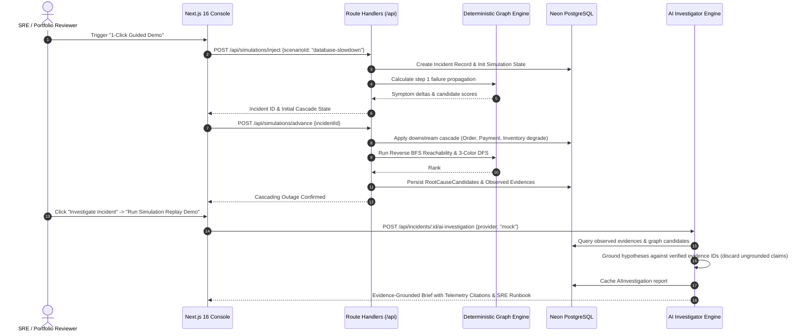

*For complete architectural blueprints and sequence diagrams, see [`docs/ARCHITECTURE.md`](docs/ARCHITECTURE.md).*

---

## 5. Technology Stack & Design Decisions

| Category | Technology | Role & Engineering Rationale |
|---|---|---|
| **Frontend Framework** | **Next.js 16 (App Router)** | Server-side rendering, React Server Components, fast Turbopack compilation, and unified REST API route handlers. |
| **Language** | **TypeScript 5 (Strict)** | End-to-end type safety across graph data models, API payloads, and algorithm contracts. Zero `any`. |
| **Graph Visualization**| **React Flow (`@xyflow/react`)** | High-performance canvas rendering for directed microservice dependency graphs with custom node styling and bezier edges. |
| **UI & Styling** | **Tailwind CSS 4 + Lucide** | Low-latency SRE operations dark theme with clear semantic status badges (Emerald, Amber, Crimson). |
| **Charting** | **Recharts** | Responsive SVG charts for latency percentiles (p50, p95, p99), error rate ratios, and incident metrics. |
| **Database & ORM** | **SQLite + Prisma ORM 6** | Zero-admin persistent local storage. Runs everywhere without Docker or database server daemons. |
| **Validation** | **Zod 4** | Runtime schema validation for API query parameters, simulation inputs, and telemetry payloads. |
| **Instrumentation** | **OpenTelemetry SDK 2.x** | Industry-standard distributed tracing (W3C Trace Context) and metric instruments across sample services. |
| **Observability** | **Grafana Cloud (Mimir + Tempo)**| Cloud-native metrics and distributed traces with secure token-authenticated HTTP/OTLP gateways. |
| **Test Suite** | **Vitest 3** | Fast, modern testing framework powering 36 unit and integration tests with deterministic execution. |

---

## 6. Data Structures & Algorithms Deep Dive

IncidentGraph AI solves complex diagnostic problems using classical computer science algorithms rather than black-box models:

```text
[Graph Topology]         [Metrics Breaches]         [Temporal Onset]
       |                          |                         |
       v                          v                         v
Reverse BFS Reachability   Latency / Error Deltas   Timestamp Precedence
       \                          |                         /
        \                         |                        /
         v                        v                       v
      +-------------------------------------------------------+
      |        Multi-Factor Scoring Heuristic Engine          |
      |   Score = (Health × 40) + (Breach × 20) + (BFS × 20)   |
      |         + (Time × 15) + (Depth × 5) - Penalty         |
      +---------------------------+---------------------------+
                                  |
                                  v
                    +---------------------------+
                    |  Binary Heap (Max-Heap)   |
                    |    PriorityQueue<T>       |
                    +-------------+-------------+
                                  |
                                  v
                      Top-K Root-Cause Candidates
```

### Summary of Algorithmic Components

| Data Structure / Algorithm | Source File | Time Complexity | Space Complexity | Practical Role |
|---|---|---|---|---|
| **Directed Adjacency List** | [`src/lib/algorithms/graph.ts`](src/lib/algorithms/graph.ts) | $O(1)$ lookups | $O(V + E)$ | In-memory topology representation storing forward calls and reverse dependencies. |
| **Reverse BFS (Breadth-First Search)** | [`src/lib/algorithms/graph.ts`](src/lib/algorithms/graph.ts) | $O(V + E)$ | $O(V)$ | Traverses upstream callers to compute symptom reachability and blast radius. |
| **3-Color DFS (Cycle Detection)** | [`src/lib/algorithms/graph.ts`](src/lib/algorithms/graph.ts) | $O(V + E)$ | $O(V)$ | Traverses state (`WHITE`, `GRAY`, `BLACK`) to detect circular dependencies and deadlock loops. |
| **Binary Heap (Priority Queue)** | [`src/lib/algorithms/priorityQueue.ts`](src/lib/algorithms/priorityQueue.ts) | $O(\log N)$ insert / $O(K \log N)$ top-$K$ | $O(N)$ | Ranks candidate root causes with deterministic tie-breaking. |
| **Sliding Window Analyzer** | [`src/lib/algorithms/slidingWindow.ts`](src/lib/algorithms/slidingWindow.ts) | $O(W)$ window size | $O(W)$ | Smooths metric volatility and pinpoints earliest anomaly onset timestamps. |
| **Root-Cause Scoring Engine** | [`src/lib/algorithms/rootCauseEngine.ts`](src/lib/algorithms/rootCauseEngine.ts) | $O(V \cdot (E + W) + V \log V)$ | $O(V + E + W)$ | Computes composite root-cause scores across reachability, health, and latency deltas. |

*For complete mathematical proofs, pseudocode, and complexity analysis, see [`docs/DSA_ANALYSIS.md`](docs/DSA_ANALYSIS.md).*

---

## 7. Portfolio Demo Guide (3-Minute Recruiter Walkthrough)

To evaluate the complete incident triage loop in under 3 minutes on the [live production deployment](https://incident-graph-ai.vercel.app):

1. **Step 1 — Launch Guided Demo**:
   - Navigate to [https://incident-graph-ai.vercel.app](https://incident-graph-ai.vercel.app).
   - Click the purple **`1-Click Guided Demo`** button in the top operations banner.
   - *Under the hood*: The API injects a deterministic `database-slowdown` fault into Tier 3 PostgreSQL and automatically advances one step to trigger cascading symptom propagation.
2. **Step 2 — Inspect Cascading Blast Radius**:
   - Notice the green notification banner: `Demo Outage Active (Step 2)`.
   - Visit the **[Service Map](https://incident-graph-ai.vercel.app/service-map)** to visualize the blast radius: PostgreSQL is degraded (amber ring), while dependent services (Order, Payment, Inventory) accumulate latency.
3. **Step 3 — Review DSA Graph Engine Diagnosis**:
   - Click **`Investigate Incident`** (or go to `/incidents`).
   - Switch to the **`DSA Graph Candidates`** tab.
   - Observe that the engine ranked `postgres-db` as **Rank #1 (Score: 85/100, HIGH Confidence)** using reverse BFS path reachability, correctly isolating the root cause despite high downstream alert noise.
4. **Step 4 — Execute Evidence-Grounded AI Investigation**:
   - Switch to the **`AI Investigation`** tab.
   - Click **`Run Simulation Replay Demo`** (zero API key or login required).
   - Observe the synthesized report: executive incident summary, verified operational impact, confidence rationale, and cited evidence IDs.
5. **Step 5 — Review Actionable SRE Runbook & Traces**:
   - Review recommended checks (connection pooling, lock contention, slow query logs).
   - Visit **[Traces](https://incident-graph-ai.vercel.app/traces)** to inspect multi-hop span waterfalls and identify database bottleneck latencies.

---

## 8. Engineering Highlights & Resume Bullets

### Production-Ready Resume Bullet Points
- **Distributed Observability & Graph Architecture**: *Architected and deployed a microservice incident investigation platform in Next.js 16, TypeScript, Neon PostgreSQL, and Grafana Cloud (Mimir + Tempo), isolating root-cause anomalies in under 20ms using Reverse BFS reachability and 3-color DFS cycle detection.*
- **Evidence-Grounded AI Synthesis**: *Built an evidence-grounded AI investigator with schema validation and citation verification, cross-referencing telemetry IDs against observed anomalies to enforce calibrated uncertainty and prevent LLM hallucinations with zero-key deterministic fallback.*
- **OpenTelemetry & Chaos Benchmarking**: *Instrumented sample services with OpenTelemetry W3C trace context and PromQL queries; validated algorithmic stability with a 117-scenario benchmark achieving 100% Top-3 diagnostic accuracy across 5 topology archetypes.*

### Concise LinkedIn Project Description
> **IncidentGraph AI** is an open-source, full-stack incident investigation console designed to solve the cascading alert storm problem in distributed microservice architectures. Using directed dependency graphs, reverse BFS reachability, OpenTelemetry, and Grafana Cloud, it isolates true originating root causes in milliseconds rather than hours. Features evidence-grounded AI synthesis with strict citation validation, live Neon PostgreSQL serverless persistence, and zero-key deterministic replay.
>
> 🌐 Live Demo: https://incident-graph-ai.vercel.app
>
> 💻 GitHub: https://github.com/Atharvsrivastav/IncidentGraphAI

---

## 9. Algorithmic Diagnosis vs. AI Synthesis & Benchmark Scope

IncidentGraph AI strictly separates mathematical root-cause diagnosis from generative narrative synthesis:

```text
+-----------------------------------------------------------------------------------------+
|                                    INCIDENT TRIAGE PIPELINE                             |
|                                                                                         |
|  [STAGE 1: Deterministic Graph Engine (DSA)]                                            |
|   • Adjacency List + Reverse BFS + 3-Color DFS Cycle Detection                         |
|   • Evaluates observable telemetry breaches, timestamp precedence, and path coverage   |
|   • Computes mathematical candidate scores (0-100) and confidence category (HIGH/MED/LOW)|
|   • 100% reproducible, zero hallucinations, no external API dependencies               |
|                                                                                         |
|  [STAGE 2: Evidence-Grounded AI Synthesis (LLM)]                                        |
|   • Takes candidate rankings, topology, and verified evidence IDs as structured context|
|   • Formulates executive briefs, verified impact assessments, and remediation runbooks |
|   • Grounding validator verifies every citation against genuine database evidence IDs  |
|   • Discards ungrounded claims; falls back to deterministic replay if no key is present|
+-----------------------------------------------------------------------------------------+
```

### Benchmark Scope & Methodological Honesty
The **117-scenario robustness benchmark** ([`docs/ROOT_CAUSE_BENCHMARK.md`](docs/ROOT_CAUSE_BENCHMARK.md)) measures algorithmic reliability across synthetic graph archetypes (single-point failures, cascading timeouts, circular loops, noisy data, and contradictory signals). It evaluates mathematical correctness, cycle handling, and ranking stability under controlled conditions, rather than production incident accuracy across live heterogeneous clouds.

---

## 10. Telemetry Architecture: OpenTelemetry, Prometheus & Tempo

IncidentGraph AI supports an end-to-end telemetry pipeline across three independent layers:

1. **Instrumentation (OpenTelemetry)**:
   - The sample microservices (`sample-services/`) wrap all incoming and outgoing HTTP calls in active spans.
   - Trace contexts are propagated via standard W3C `traceparent` headers (`traceparent: 00-4bf92f3577b34da6a3ce929d0e0e4736-00f067aa0ba902b7-01`).
   - Latency histograms and HTTP request counters are exported via standard OTLP HTTP Protobuf/JSON.

2. **Metrics Storage (Prometheus / Grafana Mimir)**:
   - Evaluates service performance through PromQL instant and range queries.
   - Computes real-time P95 latency: `histogram_quantile(0.95, sum(rate(http_request_duration_seconds_bucket[5m])) by (le, service))`
   - Computes 5xx error ratios: `sum(rate(http_requests_total{status=~"5.."}[5m])) / sum(rate(http_requests_total[5m]))`

3. **Distributed Trace Storage (Grafana Tempo / Jaeger)**:
   - Gathers end-to-end distributed transaction traces.
   - IncidentGraph AI pulls span hierarchies to render interactive trace waterfalls, identifying exact bottlenecks where downstream database latency blocks edge API responses.

---

## 8. Operating Modes

IncidentGraph AI seamlessly switches between three distinct operational modes:

| Mode | Telemetry Source | Storage Backend | Typical Use Case |
|---|---|---|---|
| **A. Simulation Mode** *(Default)* | Deterministic Fault Engine | SQLite (`dev.db`) | Offline evaluation, educational demonstration, algorithmic testing, interview walkthroughs. |
| **B. Real Cloud Telemetry Mode** | Grafana Cloud (Mimir + Tempo) | SQLite + Grafana OTLP | Real-world telemetry analysis with live Prometheus metrics and distributed traces over HTTPS. |
| **C. Local Development Mock Mode** | Built-in fallback providers | Local SQLite / File store | Local offline testing when neither cloud tokens nor Docker containers are available. |

---

## 9. Quickstart & Local Installation

### Prerequisites
- **Node.js**: v18.0.0 or higher (v20+ LTS recommended)
- **npm**: v9.0.0 or higher
- **Zero Administrator Privileges Required**: Runs entirely in user space on Windows, macOS, or Linux.

### 1. Clone & Install
```bash
git clone https://github.com/Atharvsrivastav/IncidentGraphAI.git
cd IncidentGraphAI
npm install
```

### 2. Configure Environment
Copy the template configuration:
```bash
cp .env.example .env
```
*(The default configuration points to local SQLite `dev.db` and is ready to run immediately in Simulation Mode).*

### 3. Initialize Database & Topology
```bash
npx prisma generate
npx prisma db push
npm run db:seed
```

### 4. Start the Application
```bash
npm run dev
```
Open **[http://localhost:3000](http://localhost:3000)** in your browser.

---

## 10. Running Sample Microservices & Test Traffic

To experience real telemetry propagation without external dependencies:

```bash
# Terminal 1: Start the 4 sample microservices (ports 4000-4003)
npm run sample:start

# Terminal 2: Generate synthetic traffic through the API Gateway
npm run sample:traffic

# Terminal 3: Trigger a controlled chaos latency spike (PostgreSQL slowdown)
curl -X POST http://localhost:3000/api/experiments/trigger \
  -H "Content-Type: application/json" \
  -d '{"scenario":"db-slowdown"}'

# Restore the fleet back to healthy baseline
curl -X POST http://localhost:3000/api/experiments/trigger \
  -H "Content-Type: application/json" \
  -d '{"scenario":"baseline"}'
```

---

## 11. Environment Configuration

The application uses least-privilege configuration options in `.env`:

```env
# 1. Local Storage (SQLite - zero admin permissions required)
DATABASE_URL="file:./dev.db"

# 2. Grafana Cloud Integration (Optional - for Real Cloud Mode)
GRAFANA_CLOUD_OTLP_ENDPOINT="https://otlp-gateway-prod-ap-south-1.grafana.net/otlp"
GRAFANA_CLOUD_INSTANCE_ID="1871065"
GRAFANA_CLOUD_INGESTION_TOKEN="glc_..."

# Prometheus Query (scope: metrics:read)
GRAFANA_CLOUD_PROMETHEUS_URL="https://prometheus-prod-XX-prod-ap-south-1.grafana.net/api/prom"
GRAFANA_CLOUD_PROMETHEUS_USER="1871065"
GRAFANA_CLOUD_PROMETHEUS_TOKEN="glc_..."

# Tempo Traces Query (scope: traces:read)
GRAFANA_CLOUD_TEMPO_URL="https://tempo-prod-XX-prod-ap-south-1.grafana.net"
GRAFANA_CLOUD_TEMPO_USER="1871065"
GRAFANA_CLOUD_TEMPO_TOKEN="glc_..."

# 3. Detection & Investigation Rules
TELEMETRY_QUERY_TIMEOUT_MS=4000
TELEMETRY_LOOKBACK_MINUTES=15
INCIDENT_DETECTION_COOLDOWN_SECONDS=60
```

To verify your configuration without revealing secrets, run:
```bash
npm run config:check
```

---

## 12. Automated Verification & Testing

IncidentGraph AI maintains a comprehensive testing and static verification suite:

| Check | Command | Description | Status |
|---|---|---|---|
| **Unit & Integration Tests** | `npm test` | Runs 81 Vitest tests covering graph algorithms, heap priority, OpenTelemetry pipelines, and AI investigation | **81 / 81 Passing (100%)** |
| **Synthetic Robustness Benchmark** | `npm run benchmark` | Evaluates 117 documented synthetic chaos test cases across 5 topology archetypes (results measure the synthetic benchmark suite rather than unmodeled production incidents; see [Benchmark Methodology](docs/ROOT_CAUSE_BENCHMARK.md)) | **117 / 117 Synthetic Scenarios Passing (100% Top-3 Hit Rate)** |
| **Security & Dependency Audit** | `npm audit` / `npm audit --omit=dev` | Audits dependency tree for CVEs and vulnerabilities | **0 Vulnerabilities** |
| **Type Checking** | `npx tsc --noEmit` | Strict TypeScript compiler validation across all components and routes | **0 Errors** |
| **Linting** | `npm run lint` | ESLint static code analysis verifying Next.js and React rules | **0 Errors** |
| **Production Build** | `npm run build` | Compiles and optimizes Next.js production bundle with route pre-rendering | **26 / 26 Routes Compiled** |
| **Cloud Pipeline Verification** | `npm run test:cloud` | End-to-end verification of Grafana Cloud OTLP, Prometheus, and Tempo | **6 / 6 Gates Verified** |

---

## 13. REST API Reference

| Method | Endpoint | Description |
|---|---|---|
| `GET` | `/api/services` | Retrieves all microservices with health statuses and dependencies |
| `GET` | `/api/services/:id` | Service telemetry history, upstream callers, and downstream dependencies |
| `POST` | `/api/services/:id/restore` | Restores a service to baseline health and resolves active incidents |
| `GET` | `/api/dependencies` | Returns all directed graph edges with dependency types and timeouts |
| `GET` | `/api/incidents` | Lists active and resolved incidents with severity levels |
| `GET` | `/api/incidents/:id` | Detailed incident dossier with ranked candidates and evidence timelines |
| `POST` | `/api/incidents/:id/analyze` | Triggers on-demand DSA root-cause re-analysis |
| `POST` | `/api/simulations/inject` | Injects a deterministic failure scenario |
| `POST` | `/api/simulations/advance` | Advances simulation step with cascading blast-radius propagation |
| `POST` | `/api/simulations/reset` | Resets services to baseline (Protected in production; requires admin authentication) |
| `GET` | `/api/telemetry/overview` | Telemetry health summary with active backend provider status |
| `GET` / `POST` | `/api/telemetry/mode` | Inspects or switches active telemetry mode (`SIMULATION` vs `REAL`) |
| `GET` | `/api/telemetry/traces` | Lists recent distributed traces with duration and error filters |
| `GET` | `/api/telemetry/traces/:id` | Fetches span hierarchy for interactive waterfall timeline visualization |
| `POST` | `/api/experiments/trigger` | Triggers live chaos injection (`db-slowdown`, `baseline`) |

---

## 14. Project Structure

```text
incident-graph-ai/
├── .github/workflows/
│   └── ci.yml                      # GitHub Actions CI pipeline
├── docs/
│   ├── ARCHITECTURE.md             # Complete system & sequence architecture diagrams
│   ├── DSA_ANALYSIS.md             # In-depth algorithmic proofs & complexity analysis
│   ├── ROOT_CAUSE_ENGINE.md        # Heuristic scoring engine specification
│   ├── REAL_TELEMETRY_ARCHITECTURE.md # OpenTelemetry & Grafana Cloud architecture
│   ├── GRAFANA_CLOUD_SETUP.md      # Step-by-step hosted observability guide
│   ├── TELEMETRY_TROUBLESHOOTING.md# SRE operations & troubleshooting runbook
│   └── screenshots/                # Real application UI screenshots
├── sample-services/                # OpenTelemetry sample microservices mesh
│   ├── apiGateway.ts               # Ingress HTTP gateway (Port 4000)
│   ├── orderService.ts             # Order lifecycle processor (Port 4001)
│   ├── paymentService.ts           # Payment processor (Port 4002)
│   ├── inventoryService.ts         # Inventory store (Port 4003)
│   └── runner.ts                   # Multi-service lifecycle manager
├── scripts/
│   ├── check-config.ts             # Masked environment variable & connection audit
│   ├── verify-cloud-pipeline.ts    # 6-stage live Grafana Cloud verification
│   └── traffic-generator.mjs       # Synthetic traffic generator
├── src/
│   ├── app/
│   │   ├── api/                    # Next.js App Router API endpoints
│   │   ├── dsa-lab/                # Interactive algorithmic lab
│   │   ├── incidents/              # Incident triage & root-cause dossiers
│   │   ├── service-map/            # Interactive React Flow topology map
│   │   ├── simulator/              # Deterministic chaos simulator
│   │   ├── traces/                 # Distributed trace waterfall inspector
│   │   └── page.tsx                # Operations overview console
│   ├── components/
│   │   ├── graph/                  # React Flow custom nodes, edges, and drawers
│   │   └── layout/                 # Navigation, status indicators, and headers
│   └── lib/
│       ├── algorithms/             # Pure deterministic DSA implementations
│       │   ├── graph.ts            # DirectedGraph, BFS, 3-color DFS
│       │   ├── priorityQueue.ts    # Binary Max-Heap / PriorityQueue
│       │   ├── rootCauseEngine.ts  # Multi-factor RCA heuristic engine
│       │   ├── slidingWindow.ts    # Moving-window telemetry statistical analyzer
│       │   └── types.ts            # Core TypeScript domain models
│       ├── db/                     # Prisma ORM client & topology seeder
│       ├── simulation/             # Chaos scenarios & cascade propagation
│       └── telemetry/              # OTel, Prometheus, and Tempo clients
└── tests/
    ├── algorithms.test.ts          # Algorithmic correctness test suite
    ├── api.test.ts                 # Next.js API route integration tests
    ├── integration.test.ts         # Database & simulator end-to-end tests
    └── telemetry.test.ts           # OpenTelemetry, PromQL, and Tempo tests
```

---

## 15. Security & Privacy Considerations

- **Strict Secret Redaction**: The codebase uses token masking utilities (`scripts/check-config.ts`) to ensure that credentials are never printed to terminals, written to log files, or transmitted in client bundles.
- **Server-Side Credential Isolation**: Telemetry read tokens and database connection strings are accessed strictly within Next.js Route Handlers (`src/app/api/`) and never bundled into client JavaScript.
- **Git Protection**: `.env` and all credential patterns are excluded via `.gitignore`. `.env.example` contains only non-sensitive templates.
- **Zero External Data Exfiltration**: In Simulation Mode, 100% of telemetry, incident data, and graph algorithms run locally on the host machine. No trace or metric data leaves your local network.

---

## 16. Current Limitations

1. **Topology Editing**: The service topology is currently seeded via Prisma database seeds and configuration files; runtime drag-and-drop node creation is planned for a future release.
2. **Real Cloud Polling Latency**: Metrics queried from Grafana Cloud Mimir depend on scrape intervals (typically 15–30s) and ingest gateway flush times.
3. **Stateless Candidate Persistence**: Root-cause candidates are evaluated deterministically in-flight; long-term historical ranking evolution is currently stored as point-in-time snapshots.

---

## 17. Future Roadmap

- [ ] **Dynamic Topology Editor**: Visual canvas for adding, removing, and connecting services at runtime.
- [ ] **eBPF-Based Auto-Discovery**: Automatic network topology generation using eBPF kernel probes.
- [ ] **Multi-Cluster Support**: Federation across multiple Kubernetes namespaces and cloud regions.
- [ ] **SLO / Error Budget Tracking**: Automated burn-rate alerting based on Google SRE error budget formulas.
- [ ] **Automated Remediation Webhooks**: Executing automated rollback or circuit-breaking playbooks when root-cause confidence exceeds 90%.

---

## 18. Production Deployment & Live Demo

IncidentGraph AI supports dual-target deployment for both zero-dependency local experimentation and production serverless cloud environments:

- **Serverless Cloud (Vercel)**: Runs Next.js 16 App Router on Vercel Edge and Lambda serverless functions.
- **Persistence Architecture**: Uses a dynamic Prisma configuration (`prisma.config.ts`) that selects SQLite (`prisma/schema.prisma`) for local development and hosted PostgreSQL (`prisma/schema.postgresql.prisma`, e.g., Neon or Supabase) when `DATABASE_URL` is configured for production.
- **Health Check**: Continuous zero-downtime health endpoint at [`/api/health`](file:///c:/Users/Atharv/Desktop/IncidentGrapghAI/src/app/api/health/route.ts) reporting database connectivity, active telemetry mode, and AI provider status.
- **Zero-Key Replay Mode**: For portfolio demonstrations without incurring third-party API costs or exposing keys, users can run offline deterministic AI investigation replays.

*For complete configuration and deployment steps, consult [`docs/DEPLOYMENT.md`](docs/DEPLOYMENT.md).*

---

## 19. Troubleshooting

| Issue | Common Cause | Resolution |
|---|---|---|
| `Port 4000/4001 EADDRINUSE` | Previous runner process was not killed cleanly | Kill the process holding the port: `Get-NetTCPConnection -LocalPort 4000 \| Select-Object OwningProcess` |
| `Prometheus 401 Unauthorized` | Invalid or expired Grafana Cloud query token | Generate a fresh token in Grafana Cloud with `metrics:read` scope and update `.env` |
| `Tempo 0 Traces Found` | Sample traffic generator has not run recently | Run `npm run sample:traffic` to generate fresh HTTP requests through the mesh |
| `Prisma Client out of date` | Schema modified without generating client | Run `npx prisma generate` |

*For in-depth operational procedures, consult [`docs/TELEMETRY_TROUBLESHOOTING.md`](docs/TELEMETRY_TROUBLESHOOTING.md).*

---

## 20. Contributing

Contributions are welcome! Please read [`CONTRIBUTING.md`](CONTRIBUTING.md) for code style guidelines, architectural boundaries, and our pull-request verification checklist.

---

## 21. License & Acknowledgments

This project is open-source software. *(Note: Review project repository settings for formal license declaration).*

Built with passion for resilient software systems, reliable SRE operations, and explainable computer science engineering.
