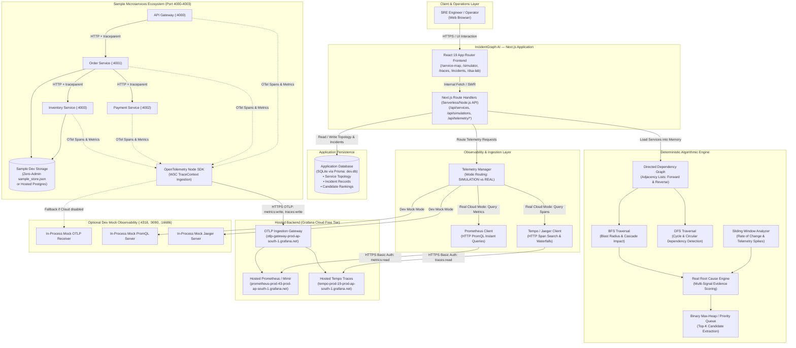
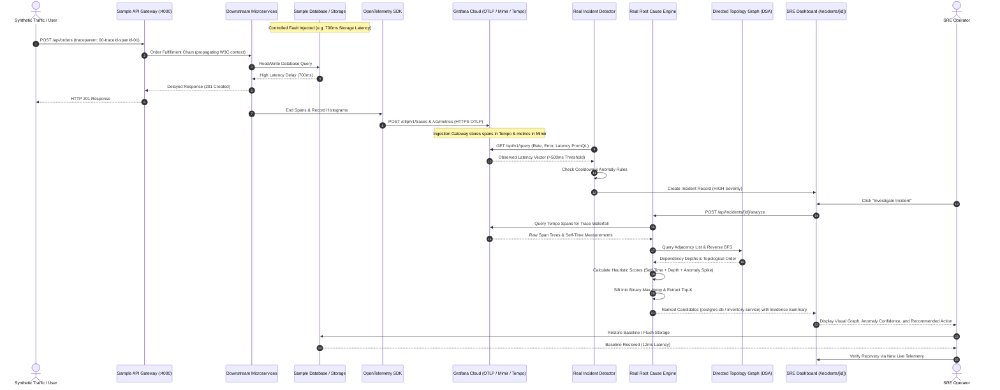

# IncidentGraph AI — System Architecture & Data Flow

IncidentGraph AI is a hybrid Site Reliability Engineering (SRE) observability and automated root-cause analysis platform. It models microservice topologies using directed graphs, collects distributed telemetry via OpenTelemetry, and ranks probable failure origins using deterministic graph-traversal algorithms and statistical scoring.

---

## 1. High-Level System Architecture

The following diagram illustrates the complete logical architecture, data boundaries, and network relationships across IncidentGraph AI.

---

## 2. Operating Modes & Data Isolation

IncidentGraph AI strictly distinguishes three operating environments to ensure test reproducibility, data integrity, and zero telemetry fabrication:

| Dimension | Simulation Mode | Real Cloud Telemetry Mode | Dev Mock Mode |
| :--- | :--- | :--- | :--- |
| **Telemetry Source** | In-memory deterministic state engine (`dev.db`). | Hosted Grafana Cloud (Prometheus & Tempo over HTTPS). | In-process HTTP test servers on `:4318`, `:9090`, `:16686`. |
| **Microservices Requirement** | None (runs standalone). | Sample services running (`npm run sample:start`). | Sample services emitting locally. |
| **Cloud Credentials** | None required. | `GRAFANA_CLOUD_*` tokens in local `.env`. | None required. |
| **Handling Unobserved Nodes** | Returns simulated status (HEALTHY / DEGRADED / DOWN). | Explicitly marked `UNKNOWN` with `No observations received`. | Emulated response format. |
| **Root-Cause Analysis Input** | Simulated step metrics and topological graph. | Actual PromQL query values, live latency anomalies, real trace span durations. | Emulated metrics and traces. |
| **Cloud Network Egress** | Zero network egress. | HTTPS calls to `prod-ap-south-1.grafana.net`. | Zero network egress. |

---

## 3. Incident Investigation & Root-Cause Analysis Workflow

The following sequence details how an incident transitions from physical HTTP request latency to verified root-cause remediation:

---

## 4. Key Architectural Guarantees

1. **Zero State Fabrication**: When Real Telemetry Mode is enabled, unobserved services are never populated with fake values. They are marked `UNKNOWN` with actionable diagnostics.
2. **Zero Admin & Local Execution**: The entire stack (Next.js, SQLite, sample services, local storage, test suites) executes on standard user permissions without Docker, WSL, or administrator privileges.
3. **Strict Credential Containment**: Cloud tokens are strictly consumed by server-side clients ([prometheusClient.ts](file:///c:/Users/Atharv/Desktop/IncidentGrapghAI/src/lib/telemetry/prometheusClient.ts), [jaegerClient.ts](file:///c:/Users/Atharv/Desktop/IncidentGrapghAI/src/lib/telemetry/jaegerClient.ts), [telemetry.ts](file:///c:/Users/Atharv/Desktop/IncidentGrapghAI/sample-services/shared/telemetry.ts)). No secrets are exposed to the browser or bundled into client code.
4. **Decoupled Database Boundaries**: The application database (`prisma/dev.db`) stores incident graph topology and UI state. The sample microservices persist business transactions independently in `sample-services/data/sample_store.json` (or a dedicated external Postgres instance). Telemetry is stored exclusively in Grafana Cloud.
