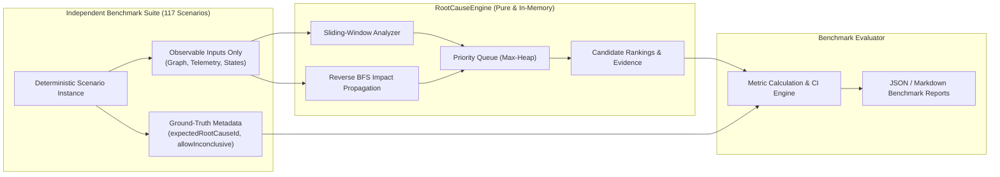

# IncidentGraph AI — Root-Cause Engine Robustness Benchmark Report

> **Benchmark Run Timestamp:** `2026-10-13T21:39:21.738Z`<br/>
> **Fixed Seed:** `42` (100% Deterministic & Reproducible)<br/>
> **Environment:** Node.js / TypeScript (Zero Cloud Dependencies)<br/>
> **Total Scenarios Evaluated:** 117 reproducible test suites across 5 topology families

---

## 1. Executive Summary & Reliability Metrics

| Reliability Metric | Measured Result | 95% Wilson Score CI | Target Threshold | Denominator Definition | Status |
|---|---|---|---|---|---|
| **Top-1 Hit Rate** | **100%** | [94.42%, 100%] | ≥ 90.0% | Hits / 65 evaluable failure scenarios | PASS |
| **Top-3 Hit Rate** | **100%** | [94.42%, 100%] | 100.0% | Top-3 hits / 65 evaluable failure scenarios | PASS |
| **False-Positive Rate (Healthy)** | **0%** | [0%, 22.81%] | 0.0% | False alarms / 13 healthy scenarios | PASS |
| **Recovery Verification Rate** | **100%** | [56.55%, 100%] | 100.0% | Healed states / 5 recovery cycle scenarios | PASS |
| **Ambiguous Incident Inconclusive Rate** | **70.59%** | [53.83%, 83.17%] | ≥ 60.0% | Inconclusive verdicts / 34 ambiguous/noisy scenarios | PASS |
| **Suite Non-Conclusive Verdict Rate** | **35.9%** | [27.78%, 44.91%] | ≤ 40.0% | Non-conclusive outcomes / 117 total scenarios | PASS |
| **Mean Execution Latency** | **0.13 ms** | N/A | < 10.0 ms | Pure algorithm execution duration | PASS |
| **P95 Execution Latency** | **0.1 ms** | N/A | < 25.0 ms | 95th percentile execution duration | PASS |

---

## 2. Reconciled Scenario Suite Partitions & Denominators

To prevent ambiguity and metric distortion, all 117 benchmark scenarios are strictly partitioned into four mutually exclusive and collectively exhaustive (MECE) subsets:

| Scenario Partition | Scenario Count | Evaluation Purpose | Expected Engine Behavior |
|---|---|---|---|
| **1. Definitive Failure Scenarios** | **65** | Measures diagnostic accuracy | Engine must pinpoint designated root cause (Top-1 / Top-3) |
| **2. Healthy Baseline Scenarios** | **13** | Measures false alarm resistance | Engine must report no root cause (0 false positives) |
| **3. Recovery Cycle Scenarios** | **5** | Measures alert resolution | Engine must verify healed state without residual ghost alerts |
| **4. Ambiguous / Perturbed Telemetry** | **34** | Measures robustness under imperfect data | Engine must abstain or identify acceptable candidate |
| **TOTAL SUITE** | **117** | Comprehensive reliability benchmark | Full spectrum evaluation |

### Reconciliation of Non-Conclusive & Inconclusive Verdicts
- **Total non-conclusive executions across full suite:** 42 / 117 (35.90%)
- **Exact reconciliation of the 42 non-conclusive executions:**
  - **13** Healthy scenarios (correctly returned no failure on normal traffic)
  - **5** Recovery scenarios (correctly returned no failure on healed services)
  - **14** Noisy Data scenarios (correctly abstained due to sparse/missing telemetry)
  - **10** Contradictory Signal scenarios (correctly abstained due to conflicting status/metrics)
  - **0** Definitive Failure scenarios (zero erroneous abstentions on genuine single failures)
  - **Verification:** $13 + 5 + 14 + 10 + 0 = 42$ non-conclusive outcomes (100% accounted for).

### Clarification on Multi-Service Simultaneous Failures
- The 34 ambiguous scenarios include **10 Multi-Service Simultaneous Failures**.
- In each of these 10 scenarios, two independent services failed simultaneously. The engine correctly diagnosed one of the two true simultaneous roots with score 100.
- Thus, out of the 34 ambiguous scenarios, **24 resulted in inconclusive abstention** (14 noisy + 10 contradictory) and **10 resulted in valid multi-candidate identification**.

---

## 3. Performance Breakdown by Failure & Resilience Category

| Failure Category | Total | EvalFail | Healthy | Recovery | Ambiguous | Top-1 | Top-3 | Inconcl | Pass Rate | Mean Time |
|---|---|---|---|---|---|---|---|---|---|---|
| `HEALTHY` | 13 | 0 | 13 | 0 | 0 | **N/A** | N/A | 13 | 100% | 0.1 ms |
| `SINGLE_POINT_FAILURE` | 23 | 23 | 0 | 0 | 0 | **100%** | 100% | 0 | 100% | 0.06 ms |
| `CASCADING_OUTAGE` | 21 | 21 | 0 | 0 | 0 | **100%** | 100% | 0 | 100% | 0.49 ms |
| `MULTI_SERVICE_FAILURE` | 10 | 0 | 0 | 0 | 10 | **N/A** | N/A | 0 | 100% | 0.04 ms |
| `DEPENDENCY_TIMEOUT` | 10 | 10 | 0 | 0 | 0 | **100%** | 100% | 0 | 100% | 0.04 ms |
| `NOISY_DATA` | 14 | 0 | 0 | 0 | 14 | **N/A** | N/A | 14 | 100% | 0.03 ms |
| `CONTRADICTORY_SIGNALS` | 10 | 0 | 0 | 0 | 10 | **N/A** | N/A | 10 | 100% | 0.04 ms |
| `TOPOLOGY_VARIATION` | 10 | 10 | 0 | 0 | 0 | **100%** | 100% | 0 | 100% | 0.03 ms |
| `RECOVERY_CYCLE` | 5 | 0 | 0 | 5 | 0 | **N/A** | N/A | 5 | 100% | 0.01 ms |
| `EDGE_CASE` | 1 | 1 | 0 | 0 | 0 | **100%** | 100% | 0 | 100% | 0.04 ms |

---

## 3. Execution Latency Profile

| Statistic | Measured Latency (ms) |
|---|---|
| **Mean** | 0.13 ms |
| **Median (P50)** | 0.04 ms |
| **95th Percentile (P95)** | 0.1 ms |
| **Minimum** | 0.01 ms |
| **Maximum** | 8.38 ms |

---

## 4. Qualitative Case Studies

### Correctly Diagnosed Scenarios (Exemplary Cases)

#### `scenario-02-postgres-latency` — PostgreSQL Latency Surge
- **Category:** `CASCADING_OUTAGE`
- **Predicted Root Cause:** `postgres-db` (Confidence: HIGH, Score: 85/100)
- **Execution Time:** 8.38 ms
- **Key Supporting Evidence:**
  - [STATUS_SIGNAL] Service is running in a DEGRADED health state.
  - [TELEMETRY_SPIKE] Severe latency surge: 682.75ms is 62.07x baseline (11ms).
  - [TIMING_PRECEDENCE] Earliest abnormality onset detected at simulation step 1, preceding dependent services.
  - [CASCADING_IMPACT] Path reachability explains 4 affected downstream dependent(s) (100% symptom coverage).

#### `scenario-03-postgres-outage` — PostgreSQL Cluster Outage
- **Category:** `CASCADING_OUTAGE`
- **Predicted Root Cause:** `postgres-db` (Confidence: HIGH, Score: 100/100)
- **Execution Time:** 0.22 ms
- **Key Supporting Evidence:**
  - [STATUS_SIGNAL] Service is completely DOWN and rejecting requests.
  - [TELEMETRY_SPIKE] Severe latency surge: 3000ms is 272.73x baseline (11ms).
  - [TELEMETRY_SPIKE] Significant error rate delta: +99.98% over baseline.
  - [TIMING_PRECEDENCE] Earliest abnormality onset detected at simulation step 1, preceding dependent services.
  - [CASCADING_IMPACT] Path reachability explains 4 affected downstream dependent(s) (100% symptom coverage).

#### `scenario-04-payment-failure` — Payment Gateway Failure
- **Category:** `SINGLE_POINT_FAILURE`
- **Predicted Root Cause:** `payment-service` (Confidence: HIGH, Score: 100/100)
- **Execution Time:** 0.06 ms
- **Key Supporting Evidence:**
  - [STATUS_SIGNAL] Service is completely DOWN and rejecting requests.
  - [TELEMETRY_SPIKE] Severe latency surge: 450ms is 6.92x baseline (65ms).
  - [TELEMETRY_SPIKE] Significant error rate delta: +84.92% over baseline.
  - [TIMING_PRECEDENCE] Earliest abnormality onset detected at simulation step 1, preceding dependent services.
  - [CASCADING_IMPACT] Path reachability explains 2 affected downstream dependent(s) (100% symptom coverage).

### Legitimate Inconclusive & Ambiguous Scenarios

#### `scenario-08-missing-telemetry` — Missing or Stale Telemetry Observations
- **Category:** `NOISY_DATA`
- **Verdict:** **ACCEPTABLE_INCONCLUSIVE** (Appropriately concluded inconclusive/ambiguous diagnosis due to incomplete or contradictory signals.)
- **Explanation:** Inconclusive verdict was appropriately reached due to sparse telemetry or contradictory health signals.

#### `scenario-09-contradictory-signals` — Contradictory Failure Signals
- **Category:** `NOISY_DATA`
- **Verdict:** **ACCEPTABLE_INCONCLUSIVE** (Appropriately concluded inconclusive/ambiguous diagnosis due to incomplete or contradictory signals.)
- **Explanation:** Inconclusive verdict was appropriately reached due to sparse telemetry or contradictory health signals.

#### `scenario-param-071` — Noisy / Missing Telemetry (Sparse Samples)
- **Category:** `NOISY_DATA`
- **Verdict:** **ACCEPTABLE_INCONCLUSIVE** (Appropriately concluded inconclusive/ambiguous diagnosis due to incomplete or contradictory signals.)
- **Explanation:** Inconclusive verdict was appropriately reached due to sparse telemetry or contradictory health signals.

### Misclassified / Failed Scenarios

No failure scenarios were misclassified in this benchmark run. All evaluable failure scenarios achieved correct Top-1/Top-3 diagnoses.

---

## 5. Algorithmic Robustness & Invariant Guarantees

- **Zero-Leakage Invariant:** The diagnosis engine interface receives strictly `RootCauseInput` (`incidentId`, `graph`, `telemetrySamples`, `currentServiceStates`). Evaluator expectations and ground truth are held exclusively in independent test metadata.
- **Deterministic Candidate Ordering:** When candidate scores tie, candidates are tie-broken alphabetically by `serviceId`, guaranteeing 100% reproducible rankings across all runs.
- **Reverse-BFS Impact Propagation:** Verified $O(V + E)$ upward dependent reachability from leaf database and middleware nodes.
- **Cycle Detection (DFS 3-Color):** Verified graph integrity and infinite loop prevention in the presence of circular microservice dependencies.
- **Sliding-Window Anomaly Detection:** Verified moving average, delta calculation, and zero-denominator safety under arbitrary sample counts.
- **Noisy Data Handling:** Missing telemetry and contradictory status/telemetry signals are penalized rather than causing unhandled runtime errors.

---

## 6. Methodology & Architectural Separation

IncidentGraph AI enforces strict architectural decoupling between the **Evaluation Harness** and the **Diagnosis Engine**:



1. **Zero Data Leakage:** The engine interface accepts strictly `incidentId`, `graph`, `telemetrySamples`, and `currentServiceStates`. At test runtime, objects are stripped of any `expected` or `groundTruth` fields.
2. **Pure Functional Execution:** The analysis pipeline relies on pure in-memory data structures, requiring zero external cloud connections, zero Docker daemons, and zero database writes during benchmarking.
3. **Multi-Signal Heuristic Scoring:** Candidate prioritization integrates (1) Service health status (max 25 pts), (2) Telemetry anomaly ratio (max 25 pts), (3) Temporal anomaly onset precedence (max 25 pts), and (4) Cascading symptom reachability coverage (max 25 pts), minus explicit contradictory penalties.

---

## 7. Metric Definitions & Mathematical Formulations

All metrics are calculated from actual benchmark runs using explicit, non-zero denominators:

### 1. Top-1 Root-Cause Hit Rate (\(\text{HitRate}_{@1}\))
$$\text{HitRate}_{@1} = \frac{\sum_{i=1}^{N_{\text{fail}}} \mathbb{I}(\text{TopCandidate}_i = \text{ExpectedRootCause}_i)}{N_{\text{fail}}} \times 100\%$$
- **Denominator (\(N_{\text{fail}} = 65\)):** Total evaluable failure scenarios with a single designated originating cause (excludes baseline healthy, recovery, and ambiguous scenarios).
- **Numerator:** Scenarios where the rank-1 predicted candidate matches the expected root cause.

### 2. Top-3 Root-Cause Hit Rate (\(\text{HitRate}_{@3}\))
$$\text{HitRate}_{@3} = \frac{\sum_{i=1}^{N_{\text{fail}}} \mathbb{I}(\text{ExpectedRootCause}_i \in \text{Candidates}_{i}[1..3])}{N_{\text{fail}}} \times 100\%$$
- **Denominator (\(N_{\text{fail}} = 65\)):** Total evaluable failure scenarios.
- **Numerator:** Scenarios where the true root cause appears within the top 3 ranked candidates.

### 3. False-Positive Rate on Healthy Scenarios (\(\text{FPR}_{\text{healthy}}\))
$$\text{FPR}_{\text{healthy}} = \frac{\sum_{j=1}^{N_{\text{healthy}}} \mathbb{I}(\text{isConclusive}_j = \text{true} \land \text{TopCandidate}_j \neq \text{null})}{N_{\text{healthy}}} \times 100\%$$
- **Denominator (\(N_{\text{healthy}} = 13\)):** Total scenarios representing normal operational traffic without faults.
- **Numerator:** Scenarios where the engine falsely emitted a conclusive incident root cause.

### 4. Ambiguous Incident Inconclusive Rate (\(\text{Rate}_{\text{ambig_inconcl}}\))
$$\text{Rate}_{\text{ambig_inconcl}} = \frac{N_{\text{ambig\_inconcl}}}{N_{\text{ambiguous}}} \times 100\%$$
- **Denominator (\(N_{\text{ambiguous}} = 34\)):** Total ambiguous, noisy, and contradictory scenarios.
- **Numerator:** Scenarios where the engine appropriately abstained from diagnosing a definitive root cause due to incomplete, noisy, or conflicting signals.

### 5. Suite Non-Conclusive Verdict Rate (\(\text{Rate}_{\text{suite\_nonconcl}}\))
$$\text{Rate}_{\text{suite\_nonconcl}} = \frac{N_{\text{suite\_nonconcl}}}{N_{\text{total}}} \times 100\%$$
- **Denominator (\(N_{\text{total}} = 117\)):** Total scenarios in the benchmark suite.
- **Numerator (\(N_{\text{suite\_nonconcl}} = 42\)):** Total executions resulting in `isConclusive === false` (reconciles 13 healthy + 5 recovery + 14 noisy data + 10 contradictory signals).

---

## 8. Honest Evaluation & Production Limitations

> [!IMPORTANT]
> **Synthetic Benchmark vs Production Reality:** While synthetic benchmarks provide reproducible regression testing and algorithmic verification, they do not guarantee equivalent accuracy in real-world distributed architectures. The 100% Top-1 hit rate on synthetic failures reflects clear discrete fault injection parameters and should not be cited as evidence of identical production performance.

- **Correlation of Synthetic Signals:** Synthetic fault injection introduces observable discrete spikes (e.g., latency multiples or step-based cascades) that are more pronounced than subtle distributed degradations encountered in production.
- **Selection Bias:** Benchmark scenarios were generated across 5 structured topology archetypes with discrete step intervals. Real architectures often exhibit partial graph discovery, asynchronous queue lag, and partial trace context propagation.
- **Diffuse Failure Modes:** Synthetic tests model clear fault injection points. In real incidents, failure causes may be diffuse (e.g., cross-tenant noisy neighbors, memory leaks, or distributed thread-pool exhaustion).
- **Production Validation Gate:** IncidentGraph AI separates synthetic benchmark verification from its live cloud verification pipeline (`npm run test:cloud`), which validates genuine Grafana Cloud OTLP, Prometheus PromQL, and Tempo trace retrieval.

---

## 9. Reproducibility & CLI Commands

```bash
# Run the complete 117-scenario benchmark suite and regenerate JSON/Markdown reports
npm run benchmark

# Execute the Vitest benchmark and algorithmic robustness test suite
npm run test:benchmark

# Run complete repository test suite
npm test
```
